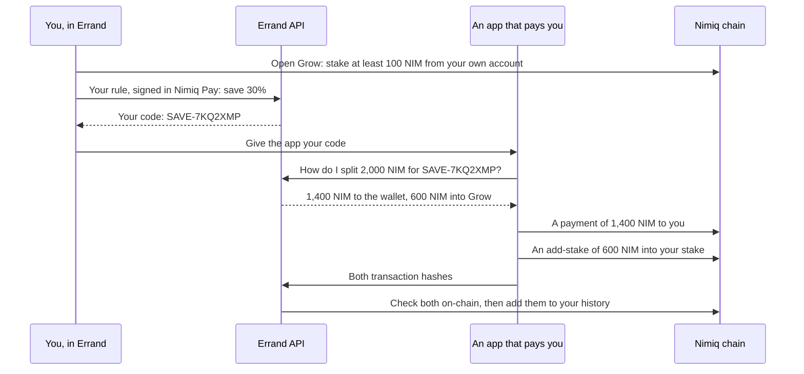

# Errand Save

Savings inside Nimiq Pay. Errand is a Mini App that keeps a share of every NIM payment other apps send you, staked in your own account. It also offers a pool where savings can keep their dollar value.

Built for the Save track of Nimiq's Mini App competition (Cycle 3). MIT licensed.

## What it does

**Save codes and Grow.** You choose how much of each payment to save, say 30%, and sign that choice once in Nimiq Pay. Errand gives you a save code such as `SAVE-7KQ2XMP`. Games, bounties and shops that pay you NIM can pay your code instead of your address: 30% goes into Grow and the rest to your wallet. Grow is NIM staked from your own account with a validator you pick. It earns staking rewards, and only you can move it.

**Steady and Boost.** A two-sided pool for NIM. Steady keeps its dollar value. Boost takes NIM's price moves for both sides: about twice NIM's ups and downs when the two sides are the same size. Unlike Grow, Errand holds this pool's NIM, so it is off by default and runs on testnet until a legal review.

**Ask Errand.** A chat about your savings. "Save 30% of what apps pay me" or "Put 500 NIM in Grow" opens the right screen with the values filled in. "When can I get my money?" is answered from your own savings. Nothing moves until you approve it in Nimiq Pay.

**Activity.** Payments in with your code, each split into its Grow and wallet parts; your own Grow transactions, read from the chain; and your Steady and Boost orders.

## Status (November 2026)

| Part | State |
|---|---|
| Save codes, Grow, Ask Errand, and the SDK for apps that pay | Built. Testnet first (`SAVE_NETWORK`). |
| Steady and Boost | Built. Off by default, and testnet only until a legal review. |
| Steady as a destination for save codes | Planned. Codes pay into Grow only for now. |
| Lightning: Bitcoin in, NIM savings out | Planned. Depends on a swap partner (Fastspot). |

The full plan, with the facts it rests on: [Errand Save — Product Plan.md](Errand%20Save%20%E2%80%94%20Product%20Plan.md).

## How save codes work



- **Grow comes first.** Errand only gives out a code once Grow is open with at least 100 NIM, Nimiq's staking minimum.
- **Your rule is a signed message.** Signing costs nothing. Errand checks that the signature belongs to your address.
- **Apps pay you directly.** On Nimiq's proof of stake, anyone can add to an existing stake without the owner's signature, so an app can pay into your Grow itself. Errand's API only tells the app how to split each payment, then records what it sent once it has checked it on-chain.
- **A payout never fails because of savings.** If Grow can't take the share, the whole payment goes to your wallet. That happens when Grow is closed, its validator is gone, or it would stay under 100 NIM.
- **Withdrawing takes 12 to 24 hours,** because Nimiq releases staked NIM at the end of an epoch. You finish it in Errand, with two approvals in Nimiq Pay.

Building an app that pays NIM? The integration guide is [packages/save/README.md](packages/save/README.md).

## How Steady and Boost work

- **Deposits.** You pay NIM to the pool's address with an order memo, and Nimiq Pay shows both before you approve. A payment counts once it's 60 blocks deep.
- **Daily settlement.** Once a day, at 12:00 UTC by default, at the median of three prices: CoinGecko, KuCoin and Gate. At least two must answer. The settlement waits, and alerts, if the prices disagree by more than 5% or moved more than 50% since the last one.
- **What happens at a settlement,** in this order:
  1. NIM's price move: Steady keeps its dollars and Boost absorbs the move.
  2. The fee: 1% a year by default.
  3. Orders, at that day's price: Steady withdrawals, Boost withdrawals, Boost deposits, Steady deposits.
- **Cover.** Steady is protected while Boost has enough NIM to cover it:
  - Steady deposits that Boost can't cover are refunded.
  - Boost withdrawals wait while Steady needs the cover.
  - If NIM falls past the cover in one day, Steady shares what's in the pool and Boost loses everything.
- **Withdrawals** are requests you sign in Nimiq Pay. They're paid out after the next settlement.
- **Pilot caps,** by default: $100 per person and $2,000 in total in Steady, and 2,000,000 NIM per person in Boost.
- **Reserves.** `GET /v1/pool/reserves` compares the pool's NIM on-chain with everything it owes.
- **The settlement maths uses whole numbers only:** luna and millionths of a dollar. A test runs 300 random settlements and checks that no NIM is ever created or lost.

## Ask Errand

- **Savings requests are read by rules, never a model.** They only open a screen with the values filled in. The chat itself can't move money.
- **Questions are answered by code,** from the user's own data (`POST /v1/save/ask`). For a question in another language, a model may pick which question it is from a fixed list and reword the answer. The rewording is shown only if it keeps every number and the save code exactly.
- **Requests Errand doesn't handle,** such as sending money or buying NIM, get a plain answer saying so, with savings suggestions.
- **The model is optional** (`OPENAI_API_KEY`) and capped at `AGENT_MODEL_CALLS_PER_DAY` calls a day. The API doesn't log what people type in the chat.

## What Errand will not do

- **Hold your Grow savings.** They stay staked in your own account.
- **Move your NIM.** Every action is a tap that opens Nimiq Pay's own approval window. Neither the Mini App nor the API holds a wallet key.
- **Let the chat move money.** Its output only opens a screen.
- **Send money or buy NIM.** It's a savings app.

Steady and Boost works differently: Errand holds that pool's NIM. So:
- it's off by default, and testnet only until a legal review;
- mainnet needs `POOL_ALLOW_MAINNET=true` as well as `POOL_NETWORK=mainnet`;
- deposits are capped;
- the only process with the pool's key is a separate worker that isn't reachable from the internet;
- anyone can check the reserves.

### How that's enforced

- **Signed requests.** Rule changes and pool withdrawals are messages the user signs in Nimiq Pay. The API checks that the signature belongs to the address, that the request is less than 10 minutes old, and that it hasn't been used before.
- **No payout goes out twice.** The payout SDK and the pool worker store each signed transaction before sending it, and resend that same transaction on a retry. A payout counts as paid only once it's on-chain.
- **The signing guard.** `pnpm check:signing` fails the build if:
  - code uses a raw signing or key API;
  - server code, or code that reads untrusted input, imports a wallet;
  - a wallet action is created anywhere other than the Savings screens' tap handlers;
  - a wallet package calls a Nimiq Pay or wallet method that isn't on its approved list;
  - a key pair appears anywhere but the payout SDK (`packages/save/src/payer.ts`) and the pool worker;
  - the Mini App or the API imports the payout SDK.

## Run it locally

You need Node 22 or later, and pnpm (`corepack enable` installs the version this repo pins).

```sh
pnpm install
cp .env.example .env                # works as it is: savings on, on testnet
pnpm --filter @railkit/api dev      # the API, on http://localhost:8787
pnpm --filter @railkit/miniapp dev  # the Mini App, on http://localhost:5173
```

- **Opening it in Nimiq Pay.** Errand only runs inside Nimiq Pay. To open it on your phone, point a tunnel (ngrok, or a free Cloudflare quick tunnel) at port 5173, then open the tunnel's address in Nimiq Pay. Use Nimiq Pay on testnet to match `SAVE_NETWORK`. The Mini App's dev server passes `/api` on to the API, so one tunnel serves both.
- **Storage.** Without `DATABASE_URL`, the API keeps everything in memory and forgets it on restart.
- **The model.** `OPENAI_API_KEY` is optional. Without it, Ask Errand uses its rules only.
- **Registering an app that pays.** Send `POST /v1/admin/save/apps` with `Authorization: Bearer <ADMIN_TOKEN>` and `{"name": "…", "payoutAddresses": ["NQ…"]}`. It returns the app's key, once.

### Steady and Boost on testnet

1. Make a pool wallet, and keep the key somewhere safe:
   ```sh
   pnpm --filter @railkit/pool-worker exec node -e "import('@nimiq/core').then(N=>{const k=N.PrivateKey.generate();console.log(N.KeyPair.derive(k).toAddress().toUserFriendlyAddress(), k.toHex())})"
   ```
2. In `.env`, set:
   - `POOL_ENABLED=true`, `POOL_NETWORK=testnet` and `POOL_ADDRESS=<address>`;
   - `VITE_POOL_ENABLED=true`;
   - a Postgres `DATABASE_URL`, which the worker needs;
   - optionally `POOL_SETTLE_EVERY_MINUTES=30`, to settle every half hour while you try it.
3. Start the worker with the key in its own environment, so the API never sees it:
   ```sh
   POOL_KEY=<key> pnpm --filter @railkit/pool-worker dev
   ```

The worker refuses to start if the key doesn't belong to the address, or if its Nimiq node follows the other network.

## Checks

```sh
pnpm run ci   # typecheck, tests, build, licence check, signing guard
```

- **Ask Errand's eval set** ([packages/agent/src/evals/sentences.ts](packages/agent/src/evals/sentences.ts)) has 94 sentences and runs with the tests. They fail on any wrong value, or if recall drops below 95%. The rules alone currently reach 99.5%.
- **`pnpm eval:model`** runs the same set with the real model. It costs about $0.02 and needs `OPENAI_API_KEY`. Run it before changing the prompt or the model.
- **The injection test** ([packages/agent/src/injection.test.ts](packages/agent/src/injection.test.ts)) pairs a hostile model with every eval sentence and with QR text. Nothing it invents may survive.
- **CI.** GitHub Actions runs these checks on every push to `main` and every pull request, and blocks GPL, AGPL and LGPL production dependencies. Every pull request also gets a preview deploy of the Mini App on Cloudflare Pages. That needs the `CLOUDFLARE_API_TOKEN` and `CLOUDFLARE_ACCOUNT_ID` repository secrets.

## Deploy on Render

[render.yaml](render.yaml) is a Render Blueprint for four services:

| Service | What it runs | Plan |
|---|---|---|
| `errand-api` | The API | Free |
| `errand-miniapp` | The Mini App, as a static site | Static site |
| `errand-db` | Postgres | Free |
| `errand-pool-worker` | Steady and Boost's worker | Starter (Render has no free workers) |

1. Push the repo to GitHub. `.env` is gitignored and never leaves your machine.
2. In Render, choose **New > Blueprint** and pick the repo. Render asks once for each secret (`sync: false`). The keys for the earlier ramp providers (Mavapay, Bitrefill, Changelly) can stay empty.
3. After the first deploy, set two addresses:
   - on `errand-api`: `ALLOWED_ORIGINS`, the Mini App's address;
   - on `errand-miniapp`: `VITE_RAILKIT_API_URL`, the API's address. Saving it rebuilds the app.
4. For a closed beta, on `errand-api`:
   - set `BETA_REQUIRED=true` and a long random `SESSION_SECRET`;
   - create invite codes with `node scripts/new-invites.mjs "Name"` and put the output in `BETA_INVITES`.
5. `errand-pool-worker` does nothing until Steady and Boost is switched on, so you can suspend it until then.

Free services sleep after about 15 minutes idle, after which the first request takes about a minute. Free Postgres is time-limited. Move to paid plans before a public launch.

## Repository layout

This repository is RailKit. It started as a toolkit for on- and off-ramps, and Errand Save is built on the parts below.

| Path | What it is |
|---|---|
| `apps/miniapp` | The Errand Mini App (React and Vite). |
| `apps/api` | The Errand API (Hono on Node). Holds no wallet keys. |
| `apps/pool-worker` | Steady and Boost's worker: watches deposits, settles and pays out. The only process with the pool's key. |
| `packages/core` | Shared logic: save codes and signed rules, payment splits, the pool's settlement maths, Nimiq addresses, and a Nimiq RPC client. |
| `packages/agent` | Ask Errand: the rules, savings answers, the optional model, and the eval set. |
| `packages/client` | A typed client for the API. |
| `packages/wallet-nimiq` | The Nimiq Pay actions. Each one opens Nimiq Pay's approval window. |
| `packages/save` | The SDK for apps that pay with save codes, and its server-side payer. Not on npm yet. |
| `packages/pool` | Steady and Boost's books and jobs. |
| `packages/adapters` | The pool's price sources, plus provider adapters from the ramp work. |

**Left from the ramp work, and not used by Errand Save:**
- the ramp routes in the API, which stay off without provider keys;
- `packages/wallet-evm`;
- the order engine and Lightning parsers in `packages/core`.

`packages/widgets`, `packages/x402`, `apps/dashboard` and `apps/docs` are empty placeholders.

## Licence

MIT. See [LICENSE](LICENSE).
