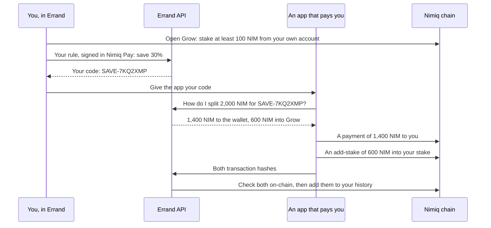

# Errand Save

Savings inside Nimiq Pay. Errand is a Mini App that keeps a share of every NIM payment other apps send you, staked in your own account.

Built for the Save track of Nimiq's Mini App competition (Cycle 3). MIT licensed.

## What it does

**Save codes and Grow.** You choose how much of each payment to save, say 30%, and sign that choice once in Nimiq Pay. Errand gives you a save code such as `SAVE-7KQ2XMP`. Games, bounties and shops that pay you NIM can pay your code instead of your address: 30% goes into Grow and the rest to your wallet. Grow is NIM staked from your own account with a validator you pick. It earns staking rewards, and only you can move it.

**The weekly draw.** Join on Savings, then keep at least 1,000 NIM in Grow on 5 of the 7 days to be in Sunday's draw at 11:59 pm (West Africa Time). One saver wins 1,000 NIM, paid straight into their Grow. Keeping more gives more tickets: 10 times as much adds one, up to 4. Nobody can lose anything, because savings never leave the saver's own account.

**Ask Errand.** A chat about your savings. "Save 30% of what apps pay me" or "Put 500 NIM in Grow" opens the right screen with the values filled in. "When can I get my money?" is answered from your own savings. Nothing moves until you approve it in Nimiq Pay.

**Activity.** Payments in with your code, each split into its Grow and wallet parts; your own Grow transactions, read from the chain; and draw wins.

## Status (November 2026)

| Part | State |
|---|---|
| Save codes, Grow, Ask Errand, and the SDK for apps that pay | Built. Testnet first (`SAVE_NETWORK`). |
| The weekly draw | Built. Testnet first; prizes are paid with `pnpm pay-prizes`. |
| Lightning: Bitcoin in, NIM savings out | Planned. Depends on a swap partner (Fastspot). |

The full plan, with the facts it rests on: [Errand Save — Product Plan.md](Errand%20Save%20%E2%80%94%20Product%20Plan.md).

## How save codes work



- **Grow comes first.** Errand only gives out a code once Grow is open with at least 100 NIM, Nimiq's staking minimum.
- **Your rule is a signed message.** Signing costs nothing. Errand checks that the signature belongs to your address.
- **Apps pay you directly.** On Nimiq's proof of stake, anyone can add to an existing stake without the owner's signature, so an app can pay into your Grow itself. Errand's API only tells the app how to split each payment, then records what it sent once it has checked it on-chain.
- **A payout never fails because of savings.** If Grow can't take the share, the whole payment goes to your wallet. That happens when Grow is closed, its validator is gone, or it would stay under 100 NIM.
- **Withdrawing takes 12 to 24 hours,** because Nimiq releases staked NIM at the end of an epoch. You finish it in Errand, with two approvals in Nimiq Pay.

Building an app that pays NIM? The integration guide is [packages/save/README.md](packages/save/README.md).

## How the weekly draw works

- **Joining** is a message signed in Nimiq Pay, plus Nimiq Pay's identifier for the phone, so each phone enters once.
- **A day counts** if the person's active stake never went under the minimum (`PRIZE_MIN_NIM`) at any moment that day. Errand reads that from the chain:
  - only the owner can lower their active stake, and only with a set-active-stake transaction, which records the new amount;
  - others can only add to a stake, so leaving their add-stakes out can only make a day look lower, never higher;
  - Errand also reads stakes every few hours and whenever the person opens Errand, which catches rises such as app payouts and rewards.
- **Tickets** follow the amount kept on 5 days, so a one-day top-up doesn't change them: 1 ticket at the minimum, one more for each 10 times as much, up to 4.
- **The draw** is at Sunday 23:59, in the time zone set by `PRIZE_UTC_OFFSET_MINUTES`. Entries are numbered in address order, and the winning ticket is the hash of the first block made after the draw time, modulo the total. Each draw is stored with its entries, so it can be worked out again. It doesn't matter when the API gets round to it, which is why sleeping on Render's free plan is fine: the block decides.
- **Paying** is done by `pnpm pay-prizes`, which holds the prize wallet's key outside the API:
  1. it asks the API who won;
  2. it stores what it signs with the API before sending, so a retry resends the same transaction;
  3. it pays into the winner's Grow, or their wallet if their validator has gone;
  4. the API marks the prize paid once the chain shows it.
- **Limits:**
  - someone with several phones can enter several accounts;
  - an account with more than 500 transactions in a week can't be scored that week;
  - prize draws are regulated in many countries, so get legal advice before paying real prizes on mainnet.

## Ask Errand

- **Savings requests are read by rules, never a model.** They only open a screen with the values filled in. The chat itself can't move money.
- **Questions are answered by code,** from the user's own data (`POST /v1/save/ask`). For a question in another language, a model may pick which question it is from a fixed list and reword the answer. The rewording is shown only if it keeps every number and the save code exactly.
- **Requests Errand doesn't handle,** such as sending money or buying NIM, get a plain answer saying so, with savings suggestions.
- **The model is optional** (`OPENAI_API_KEY`) and capped at `AGENT_MODEL_CALLS_PER_DAY` calls a day. The API doesn't log what people type in the chat.

## What Errand will not do

- **Hold your savings.** They stay staked in your own account.
- **Move your NIM.** Every action is a tap that opens Nimiq Pay's own approval window. Neither the Mini App nor the API holds a wallet key.
- **Let the chat move money.** Its output only opens a screen.
- **Send money or buy NIM.** It's a savings app.

### How that's enforced

- **Signed requests.** Rule changes, and joining or leaving the draw, are messages the user signs in Nimiq Pay. The API checks that the signature belongs to the address, that the request is less than 10 minutes old, and that it hasn't been used before.
- **No payout goes out twice.** The payout SDK stores each signed transaction before sending it, and resends that same transaction on a retry. A payout counts as paid only once it's on-chain.
- **The signing guard.** `pnpm check:signing` fails the build if:
  - code uses a raw signing or key API;
  - server code, or code that reads untrusted input, imports a wallet;
  - a wallet action is created anywhere other than the Savings screens' tap handlers;
  - a wallet package calls a Nimiq Pay or wallet method that isn't on its approved list;
  - a key pair appears anywhere but the payout SDK (`packages/save/src/payer.ts`);
  - the Mini App or the API imports the payout SDK.

## Run it locally

You need Node 22 or later, and pnpm (`corepack enable` installs the version this repo pins).

```sh
pnpm install
cp .env.example .env                # works as it is: savings on, on testnet
pnpm --filter @railkit/api dev      # the API, on http://localhost:8787
pnpm --filter @railkit/miniapp dev  # the Mini App, on http://localhost:5173
```

- **Opening it in Nimiq Pay.** Errand only runs inside Nimiq Pay. To open it on your phone, point a tunnel (ngrok, or a free Cloudflare quick tunnel) at port 5173, then open the tunnel's address in Nimiq Pay. Use Nimiq Pay on testnet to match `SAVE_NETWORK`. The Mini App's dev server passes `/api` on to the API, so one tunnel serves both.
- **Storage.** Without `DATABASE_URL`, the API keeps everything in memory and forgets it on restart.
- **The model.** `OPENAI_API_KEY` is optional. Without it, Ask Errand uses its rules only.
- **Registering an app that pays.** Send `POST /v1/admin/save/apps` with `Authorization: Bearer <ADMIN_TOKEN>` and `{"name": "…", "payoutAddresses": ["NQ…"]}`. It returns the app's key, once.
- **Paying draw prizes.** `pnpm pay-prizes` pays any unpaid prizes; add `--watch` to keep it running. On testnet, the first run makes a prize wallet in `.env.prize` (gitignored), fills it from the faucet, and prints the address to set as `PRIZE_ADDRESS`.
- **Trying a payment without building an app.** `pnpm pay-save-code SAVE-XXXXXXX 2000` plays an app that pays 2,000 NIM to a save code, on testnet. The first run gives it a wallet from the testnet faucet and registers it with your local API, which needs `ADMIN_TOKEN`.

## Checks

```sh
pnpm run ci   # typecheck, tests, build, licence check, signing guard
```

- **Ask Errand's eval set** ([packages/agent/src/evals/sentences.ts](packages/agent/src/evals/sentences.ts)) has 94 sentences and runs with the tests. They fail on any wrong value, or if recall drops below 95%. The rules alone currently reach 99.5%.
- **`pnpm eval:model`** runs the same set with the real model. It costs about $0.02 and needs `OPENAI_API_KEY`. Run it before changing the prompt or the model.
- **The injection test** ([packages/agent/src/injection.test.ts](packages/agent/src/injection.test.ts)) pairs a hostile model with every eval sentence and with QR text. Nothing it invents may survive.
- **CI.** GitHub Actions runs these checks on every push to `main` and every pull request, and blocks GPL, AGPL and LGPL production dependencies. Every pull request also gets a preview deploy of the Mini App on Cloudflare Pages. That needs the `CLOUDFLARE_API_TOKEN` and `CLOUDFLARE_ACCOUNT_ID` repository secrets.

## Deploy on Render

[render.yaml](render.yaml) is a Render Blueprint for three services:

| Service | What it runs | Plan |
|---|---|---|
| `errand-api` | The API | Free |
| `errand-miniapp` | The Mini App, as a static site | Static site |
| `errand-db` | Postgres | Free |

1. Push the repo to GitHub. `.env` is gitignored and never leaves your machine.
2. In Render, choose **New > Blueprint** and pick the repo. Render asks once for each secret (`sync: false`). The keys for the earlier ramp providers (Mavapay, Bitrefill, Changelly) can stay empty.
3. After the first deploy, set two addresses:
   - on `errand-api`: `ALLOWED_ORIGINS`, the Mini App's address;
   - on `errand-miniapp`: `VITE_RAILKIT_API_URL`, the API's address. Saving it rebuilds the app.
4. For a closed beta, on `errand-api`:
   - set `BETA_REQUIRED=true` and a long random `SESSION_SECRET`;
   - create invite codes with `node scripts/new-invites.mjs "Name"` and put the output in `BETA_INVITES`.

Free services sleep after about 15 minutes idle, after which the first request takes about a minute. Free Postgres is time-limited. Move to paid plans before a public launch.

## Repository layout

This repository is RailKit. It started as a toolkit for on- and off-ramps, and Errand Save is built on the parts below.

| Path | What it is |
|---|---|
| `apps/miniapp` | The Errand Mini App (React and Vite). |
| `apps/api` | The Errand API (Hono on Node). Holds no wallet keys. |
| `packages/core` | Shared logic: save codes and signed rules, payment splits, the weekly draw's rules, Nimiq addresses, and a Nimiq RPC client. |
| `packages/agent` | Ask Errand: the rules, savings answers, the optional model, and the eval set. |
| `packages/client` | A typed client for the API. |
| `packages/wallet-nimiq` | The Nimiq Pay actions. Each one opens Nimiq Pay's approval window. |
| `packages/save` | The SDK for apps that pay with save codes, and its server-side payer. Not on npm yet. Also the tools behind `pnpm pay-save-code` and `pnpm pay-prizes`. |

**Left from the ramp work, and not used by Errand Save:**
- the ramp routes in the API, which stay off without provider keys, and their provider adapters in `packages/adapters`;
- `packages/wallet-evm`;
- the order engine and Lightning parsers in `packages/core`.

`packages/widgets`, `packages/x402`, `apps/dashboard` and `apps/docs` are empty placeholders.

## Licence

MIT. See [LICENSE](LICENSE).
