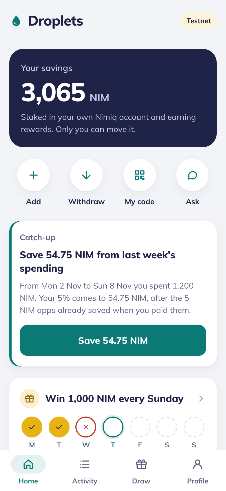
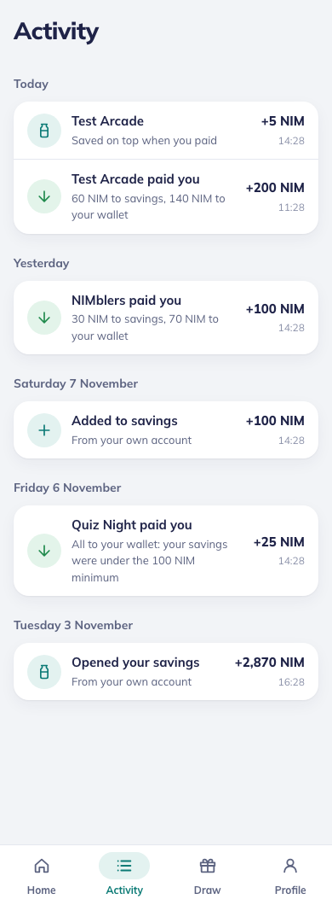
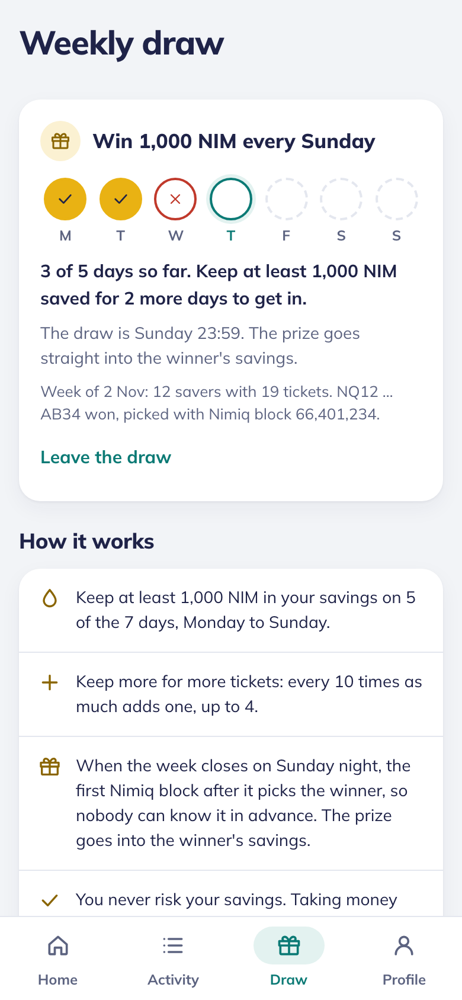
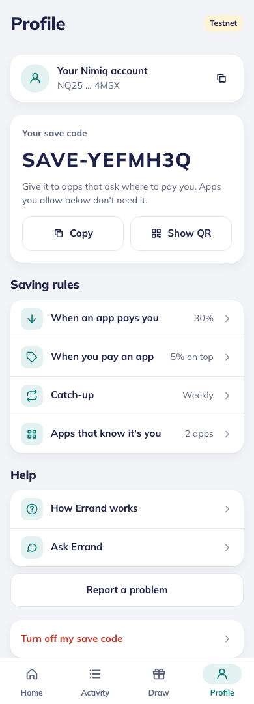
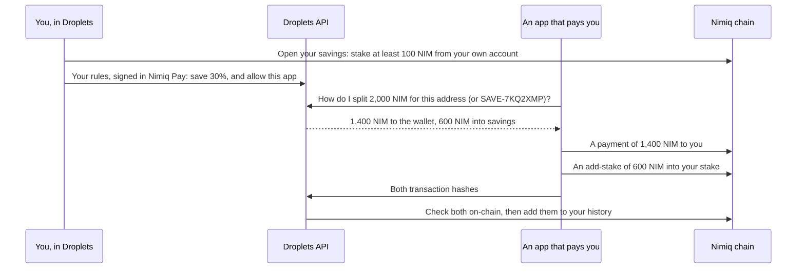

# Droplets

**Every payment leaves a droplet.**

Droplets is a Nimiq Pay Mini App that puts part of every payment into savings you own: NIM staked from your own Nimiq account, earning staking rewards, that only you can move.

Built for the Save track of the [Nimiq Mini Apps Competition](https://miniappscompetition.com) (Cycle III).


<p align="center">
  
  &nbsp;&nbsp;
  
  &nbsp;&nbsp;
  
  &nbsp;&nbsp;
  
</p>
<p align="center"><sub>Home, Activity, Draw and Profile, with demo data.</sub></p>

## Contents

- [Features](#features)
- [How it works](#how-it-works)
- [Getting started](#getting-started)
- [Configuration](#configuration)
- [For app developers](#for-app-developers)
- [API](#api)
- [Project structure](#project-structure)
- [Security](#security)
- [Testing](#testing)
- [Deployment](#deployment)
- [Status and roadmap](#status-and-roadmap)
- [Licence](#licence)

## Features

- **Savings you own.** Your savings are NIM staked from your own account, with a validator Droplets suggests or one you choose. Droplets never holds them, and withdrawing takes 12 to 24 hours, so savings are never one tap from being spent.
- **Save from what apps pay you.** Choose a share, such as 30%. Games, bounties and shops that work with Droplets put that share straight into your savings: either the apps you allow, which recognise the address they already pay, or the apps you give your save code (`SAVE-7KQ2XMP`). Apps register with Droplets first, and their key works once they're approved.
- **Save when you pay.** Apps you allow add a share, such as 5%, on top of what you buy, and put it into your savings.
- **The catch-up.** For payments anywhere else, Droplets adds up your share daily, weekly, every two weeks or monthly, and asks you to save it with one approval.
- **The weekly draw.** Keep at least 1,000 NIM saved on 5 of the 7 days to be in Sunday's draw for 1,000 NIM. Saving more gives more tickets, and you never risk your savings.
- **Ask Droplets.** Ask about your savings in plain words ("When can I get my money?"), or ask for a change ("Save 30% of what apps pay me", "Withdraw 200 NIM") and confirm it right in the chat.
- **Activity.** Every payment in, every saving, and your own staking transactions, grouped by day.

Nothing moves without your approval: every action opens Nimiq Pay's own approval window.

## How it works

### Saving from payouts

Apps pay you directly. Droplets' API only tells them how to split each payment, then records what they sent once it has checked it on-chain.



- **Anyone can add to a stake.** On Nimiq's proof of stake, an add-stake needs no signature from the owner, so an app can pay into your savings itself. Only you can take money out.
- **Your rules are a signed message.** Signing is free. Droplets checks the signature belongs to your address.
- **Apps can't probe who saves.** An app you haven't allowed gets "pay it all to the wallet", the same answer as for someone who doesn't use Droplets.
- **A payment never fails because of savings.** If your savings can't take the share (they're closed, the validator has gone, or they'd stay under Nimiq's 100 NIM staking minimum), the whole payment goes to your wallet.

### Saving when you pay, and the catch-up

- **In apps you allow,** the app asks Droplets what to charge: the price, plus your share on top. You approve the total once, and the app puts the share into your savings, or back into your wallet if your savings can no longer take it.
- **Everywhere else,** nothing can take NIM from a wallet by itself. So once each day, week, two weeks or month ends, Droplets works out your share of what you spent, less what apps already saved, and shows it with a Save button.
- **Reading what you spent.** Nimiq Pay keeps your spendable NIM in an HTLC it co-signs, funded from your wallet address and replaced about weekly, and sends payments and staking from it. So Droplets reads your wallet and every HTLC it funded (`ownHistory` in `packages/core`). That reading also gives Activity and the weekly draw your staking transactions.

### The weekly draw

- **Entering.** Joining is a signed message plus Nimiq Pay's identifier for the phone, so each phone enters once.
- **Counting days.** A day counts if your stake never went under the minimum at any moment that day. Only you can lower your stake, and only with a transaction that records the new amount, so Droplets reads every drop from the chain.
- **Tickets.** You get 1 ticket at the minimum and one more for each 10 times as much, up to 4, based on the amount kept on 5 days.
- **Picking the winner.** The draw closes on Sunday at 23:59 (`PRIZE_UTC_OFFSET_MINUTES`, West Africa Time by default). The hash of the first Nimiq block after that picks the winning ticket, so nobody can know it in advance. Each draw is stored with its entries, so anyone can check it.
- **Paying.** `pnpm pay-prizes` pays the prize into the winner's savings from a prize wallet whose key never reaches the API. The API marks it paid once the chain shows it.

Prize draws are regulated in many countries. Get legal advice before paying real prizes on mainnet.

## Getting started

### Prerequisites

- Node.js 22 or later
- pnpm 12 (`corepack enable` installs the version this repo pins)

### Install and run

```sh
pnpm install
cp .env.example .env                # works as it is: savings on, on testnet
pnpm --filter @railkit/api dev      # the API, on http://localhost:8787
pnpm --filter @railkit/miniapp dev  # the Mini App, on http://localhost:5173
```

Without `DATABASE_URL`, the API keeps everything in memory and forgets it on restart.

### Try it in a browser (demo mode)

Droplets normally runs only inside Nimiq Pay. In development, open [http://localhost:5173/?demo](http://localhost:5173/?demo) to see it with made-up savings and no wallet:

- `?demo=new` shows someone who hasn't started saving;
- `&tab=activity`, `&tab=draw` or `&tab=profile` opens that tab.

Demo mode only exists in the dev server, and production builds leave it out. Buttons that need Nimiq Pay won't work in it.

### Open it in Nimiq Pay

Point a tunnel (ngrok, or a free Cloudflare quick tunnel) at port 5173 and open the tunnel's address in Nimiq Pay, on the same network as `SAVE_NETWORK`. The Mini App's dev server passes `/api` on to the API, so one tunnel serves both.

### Testnet tools

| Command | What it does |
|---|---|
| `pnpm pay-save-code SAVE-XXXXXXX 2000` | Plays an app ("Test Arcade") that pays 2,000 NIM to a save code. |
| `pnpm pay-save-code "NQ.." 2000` | Pays an address, which only splits if its owner allowed Test Arcade. |
| `pnpm pay-save-code --spend "NQ.." 100` | Plays a 100 NIM purchase with saving on top. |
| `pnpm pay-prizes [--watch]` | Pays unpaid draw prizes. On testnet, the first run makes a prize wallet in `.env.prize` (gitignored) and fills it from the faucet. |

The first `pay-save-code` run gives Test Arcade a wallet from the testnet faucet and registers it with your local API, which needs `ADMIN_TOKEN`.

## Configuration

Settings live in `.env` (gitignored). [.env.example](.env.example) lists them all with notes. The main ones:

| Variable | Purpose |
|---|---|
| `SAVE_NETWORK` | `testnet` or `mainnet`. Must match the network Nimiq Pay runs on. |
| `DATABASE_URL` | Postgres. Without it, everything is kept in memory. |
| `ADMIN_TOKEN` | Bearer token for the `/v1/admin/` endpoints: registering apps and paying prizes. |
| `ALLOWED_ORIGINS` | The Mini App's address, for CORS. |
| `NIMIQ_RPC_URL` | Nimiq node. Defaults to `rpc.nimiqwatch.com` or its testnet twin. |
| `SAVE_VALIDATORS` | Validators suggested when someone opens their savings. |
| `PRIZE_ENABLED`, `PRIZE_NIM`, `PRIZE_MIN_NIM`, `PRIZE_DAYS`, `PRIZE_UTC_OFFSET_MINUTES` | The weekly draw's rules. |
| `PRIZE_ADDRESS` | The prize wallet's address, so the API can check payouts. Its key stays with `pnpm pay-prizes`. |
| `OPENAI_API_KEY`, `OPENAI_MODEL`, `AGENT_MODEL_CALLS_PER_DAY` | Optional model for Ask Droplets. Without a key, it uses its rules only. |
| `BETA_REQUIRED`, `BETA_INVITES`, `SESSION_SECRET` | An optional closed beta with invite codes. |
| `VITE_RAILKIT_API_URL` | The API's address, for the Mini App build. Only `VITE_` values reach the browser, so never put a key in one. |

## For app developers

Apps that pay people NIM, or take payments, can save for their users with the SDK in [packages/save](packages/save/README.md):

```ts
// Pay the address you already pay: split by the user's rule if they allowed your app.
await payer.pay({ to: userAddress, luna: 200_000_000n, payoutId: "bounty-81" });

// Spend and save: charge the quoted total, then put the share into the user's savings.
const quote = await api.spend(userAddress, 10_000_000n);
await payer.saveFromSpend({ to: userAddress, luna: quote.saveLuna, payoutId: "order-7-save" });
```

The SDK signs with your own payout key on your server, is safe to retry, and never waits on Droplets: if Droplets doesn't answer, it pays normally. The SDK isn't on npm yet.

### Registering an app

Apps sign up on the landing page, the page Droplets shows in an ordinary browser, under **For apps > Register your app**. They give a name, an optional https link, a way to reach them, and up to 5 addresses they pay from. They get their key at once, shown only that time. The key works only after the team approves the app; until then the app isn't in the public list and users can't pick it. That way, signing up can't be used to try save codes and find out who uses Droplets. Only completed sign-ups count toward the limit of 3 an hour from one place.

When an app signs up, the API posts to `ALERT_WEBHOOK_URL` if you set it. Then open the admin page at `/admin` on the Mini App's address (`https://droplets-app.onrender.com/admin`) and sign in with `ADMIN_TOKEN`. The page isn't linked from anywhere and tells search engines to skip it, and the token is kept only until the tab closes. It lets you:

- **Review sign-ups** and approve them.
- **See each approved app's usage:** payments, people, NIM saved (and how much of it on top of purchases), NIM paid to wallets, how many people picked it, and its last payment.
- **Edit** an app's name, link, contact or payout addresses.
- **Replace its key** if one leaks: the old key stops working at once and the new one is shown once.
- **Remove** an app: its key stops working and it leaves the list. People's savings aren't touched.
- **Add an app yourself,** approved straight away.

The same things are available over the API with the admin token:

```bash
curl -H "Authorization: Bearer $ADMIN_TOKEN" https://droplets-api.onrender.com/v1/admin/save/apps                    # every app, with usage
curl -X POST   -H "Authorization: Bearer $ADMIN_TOKEN" https://droplets-api.onrender.com/v1/admin/save/apps/APP_ID/approve
curl -X PATCH  -H "Authorization: Bearer $ADMIN_TOKEN" -H "Content-Type: application/json" -d '{"url":"https://example.com"}' https://droplets-api.onrender.com/v1/admin/save/apps/APP_ID
curl -X POST   -H "Authorization: Bearer $ADMIN_TOKEN" https://droplets-api.onrender.com/v1/admin/save/apps/APP_ID/key
curl -X DELETE -H "Authorization: Bearer $ADMIN_TOKEN" https://droplets-api.onrender.com/v1/admin/save/apps/APP_ID
```

Apps the team adds itself with `POST /v1/admin/save/apps` are approved straight away.

## API

The API ([apps/api](apps/api)) is Hono on Node. It holds no wallet keys.

| Endpoint | Who calls it | What it does |
|---|---|---|
| `POST /v1/save/rule` | The Mini App | Sets or changes the user's signed rules. |
| `GET /v1/save/me` | The Mini App | The savings screens: balance, code, rules, payments in. |
| `GET /v1/save/activity` | The Mini App | The history, newest first. |
| `GET /v1/save/catchup` | The Mini App | The catch-up for spending elsewhere. |
| `GET /v1/save/apps`, `GET /v1/save/validators` | The Mini App, the landing page | Approved apps users can allow, and validators to stake with. |
| `POST /v1/save/apps/register` | The landing page | An app signs up. It waits for review, and its key works once approved. |
| `POST /v1/save/ask` | The Mini App | Ask Droplets' answers about the user's own savings. |
| `GET /v1/save/split`, `GET /v1/save/spend`, `POST /v1/save/receipts` | Paying apps (app key) | How to split a payment, what to charge, and what was sent. |
| `POST /v1/prize/join`, `GET /v1/prize/me`, `GET /v1/prize/draws` | The Mini App | The weekly draw. |
| `/v1/admin/save/apps`, `/v1/admin/prize/*` | Admin token | Adding, approving, editing, re-keying and removing apps (the `/admin` page), and the prize payout tool. |

## Project structure

This repository is RailKit, a pnpm workspace. Droplets is built on these parts:

| Path | What it is |
|---|---|
| [apps/miniapp](apps/miniapp) | The Mini App: React and Vite. |
| [apps/api](apps/api) | The API: Hono on Node, with Postgres. |
| [packages/core](packages/core) | Shared logic: save codes and signed rules, payment splits, the catch-up, the draw's rules, a Nimiq RPC client and the own-accounts reader. |
| [packages/agent](packages/agent) | Ask Droplets: the rules, savings answers, the optional model and the eval set. |
| [packages/client](packages/client) | A typed client for the API. |
| [packages/wallet-nimiq](packages/wallet-nimiq) | The Nimiq Pay actions, each opening Nimiq Pay's approval window. |
| [packages/save](packages/save) | The SDK for apps, its server-side payer, and the testnet tools. |

Names in the code that users don't see:
- the user's savings are called Grow (`grow`, `growLuna`, `GrowState`);
- the app was called Errand while it was being built. Signed messages still begin with `Errand save code` and `Errand weekly draw`, because the API checks that text exactly, and some internal settings keep the old name, such as `ERRAND_API_URL` for the testnet tools.

The repository started as a toolkit for on- and off-ramps. These parts are left from that work and aren't used by Droplets:
- the ramp routes in the API, which stay off without provider keys, and their adapters in `packages/adapters`;
- `packages/wallet-evm`;
- the order engine and Lightning parsers in `packages/core`.

`packages/widgets`, `packages/x402`, `apps/dashboard` and `apps/docs` are empty placeholders.

## Security

**Droplets never:**
- **holds your savings.** They stay staked in your own account.
- **moves your NIM.** Every action is a tap that opens Nimiq Pay's own approval window. Neither the Mini App nor the API holds a wallet key.
- **lets the chat move money on its own.** A change from the chat shows its exact values with a Confirm button, and Nimiq Pay then asks you to approve it. If anything in the request is unclear, the form opens instead.

**How that's enforced:**
- **Signed requests.** Rule changes, and joining or leaving the draw, are messages the user signs in Nimiq Pay. The API checks the signature belongs to the address, that the request is under 10 minutes old, and that it hasn't been used before.
- **No payout goes out twice.** The SDK stores each signed transaction before sending it and resends that same transaction on a retry. A payout counts as paid only once it's on-chain.
- **The signing guard.** `pnpm check:signing` fails the build if:
  - code uses a raw signing or key API;
  - server code, or code that reads untrusted input, imports a wallet;
  - a wallet action is created outside the screens' tap handlers or the chat's Confirm card, or the chat itself imports a wallet;
  - a key pair appears anywhere but the SDK's payer;
  - the Mini App or the API imports the payer.
- **Ask Droplets is checked too.** Savings requests are read by rules, never a model. A model may only reword an answer, and the rewording is shown only if it keeps every number and the save code exactly. The API doesn't log what people type.

## Testing

```sh
pnpm run ci   # type checks, tests, build, licence check, signing guard
```

- **Tests** use Vitest, with an in-memory Postgres (pg-mem) for the stores.
- **Ask Droplets' eval set** ([packages/agent/src/evals](packages/agent/src/evals)) has 96 sentences and runs with the tests. They fail on any wrong value, or if recall drops below 95%. `pnpm eval:model` runs the same set against the real model (needs `OPENAI_API_KEY`).
- **The injection test** pairs a hostile model with every eval sentence. Nothing it invents may survive.
- **GitHub Actions** runs these checks on every push to `main` and every pull request. It blocks GPL, AGPL and LGPL production dependencies, and deploys a preview of the Mini App to Cloudflare Pages.

## Deployment

[render.yaml](render.yaml) is a Render Blueprint for the API (`droplets-api`) and the Mini App as a static site (`droplets-app`). It's set up for testnet, open to everyone, with the API and the Mini App already pointing at each other's `onrender.com` addresses. The database is any Postgres you give it: the free tier of [Neon](https://neon.tech) works well.

1. Create a Postgres database and copy its **direct** connection string, not the pooled one, because the API runs its own table migrations at startup. With Neon that's the host without `-pooler`. If your Neon login came from Vercel, create it in Vercel under **Storage > Create Database > Neon**, then copy `DATABASE_URL_UNPOOLED`.
2. Push the repo to GitHub, then in Render choose **New > Blueprint** and pick it.
3. Render asks for `DATABASE_URL`: paste the connection string. It also asks for two optional secrets, `OPENAI_API_KEY` and `ALERT_WEBHOOK_URL`; leave them empty if you don't use them.
4. Once both services are live, open `https://droplets-app.onrender.com` in Nimiq Pay.

If Render gives either service a different address, update `ALLOWED_ORIGINS` on the API and `VITE_RAILKIT_API_URL` on the Mini App to match.

**Going to mainnet:** set `SAVE_NETWORK=mainnet`, and set `PRIZE_ADDRESS` to a mainnet prize wallet you fund, or switch the draw off with `PRIZE_ENABLED=false`.

**For an invite-only beta:** set `BETA_REQUIRED=true` and a long random `SESSION_SECRET`, and create invite codes with `node scripts/new-invites.mjs "Name"` for `BETA_INVITES`.

Free Render services sleep after about 15 minutes idle, so the first request then takes about a minute. The weekly draw doesn't mind sleeping, because a block picks the winner, not the time the job runs. Move the API to a paid plan for a public launch.

## Status and roadmap

| | |
|---|---|
| **Built** | Savings, save codes, apps you allow, saving when you pay, the catch-up, the weekly draw, Ask Droplets, and the SDK for apps. Running on testnet (`SAVE_NETWORK`). |
| **Next** | Mainnet, with the first partner apps, self-serve sign-up for apps, and the SDK on npm. |
| **Planned** | Bitcoin Lightning in, NIM savings out, which depends on a swap partner. |

## Licence

MIT. See [LICENSE](LICENSE).
